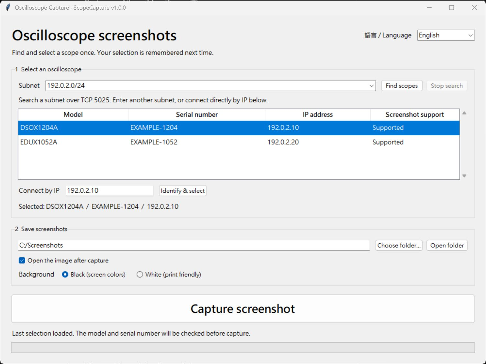

# ScopeCapture

[繁體中文](README.zh-TW.md) | English

**One click to save your Keysight oscilloscope screen to your Windows PC.**

A small desktop app for the times you just want a screenshot without moving a USB drive between the scope and your computer. Find your instrument, select it once, and capture its screen as a PNG.

**[Download for Windows x64](https://github.com/adrianhsu68/ScopeCapture/releases/latest)** · [User guide](docs/guide.en.txt) · [Report an issue](https://github.com/adrianhsu68/ScopeCapture/issues)



*Example interface using demonstration addresses and serial numbers.*

## Features

- Portable Windows EXE: no installation of Python, VISA, or Keysight IO Libraries needed.
- Search an IPv4 subnet or enter an instrument's IP address directly.
- Select by model and serial number, with the last instrument remembered.
- Choose black or white backgrounds; Ink Saver is restored after capture.
- Save timestamped PNGs containing the model and serial number in the filename.
- Open the image automatically, or keep capturing to the chosen folder.
- Switch between English and Traditional Chinese without restarting.
- Remember the language, instrument, folder, background, and image-opening preference.

## Quick start

1. Download the ZIP from [Releases](https://github.com/adrianhsu68/ScopeCapture/releases/latest) and extract it.
2. Connect the scope and PC to a reachable network, then run `ScopeCapture.exe`.
3. Click **Find scopes**, or enter the scope's IP and click **Identify & select**.
4. Select the correct serial number, choose a save folder and background, and click **Capture screenshot**.

Windows 10/11 x64. Communication uses IPv4 and raw SCPI on TCP **5025**. USB connections are not implemented. Subnet suggestions use /24; edit the range to match your network. Search accepts up to /22 (1024 addresses). Firewalls or VLAN isolation may prevent discovery or connection.

The EXE is unsigned. If your organization blocks it, ask IT to review the package. Do not disable security software to run it.

## Supported instruments

| Model | Status |
| --- | --- |
| Keysight DSOX1204A | Hardware-tested discovery, screenshot capture, black/white backgrounds, and Ink Saver restoration |
| Keysight EDUX1052A | Confirmed working on hardware by a user |
| Keysight EDUX1052G, DSOX1202A/G, DSOX1204G | Implemented from the shared programming guide; hardware verification pending |

The models share the [Keysight 1200 X-Series / EDUX1052A/G programming guide](https://www.keysight.com/us/en/assets/9018-07747/programming-guides/9018-07747.pdf). Other SCPI devices may appear in the search list, but screenshot capture is restricted to the models above. This project is independent and is not affiliated with Keysight.

The app checks model and serial number before every capture. If DHCP changes the instrument's address, search again and select it. A remembered instrument is not a live connection indicator.

## What capture changes

Capture reads the current display. It does not send Run/Stop or Autoscale, or change acquisition settings. It temporarily sets Ink Saver when necessary, then restores and verifies the original value. After an incomplete response or timeout, no further commands are sent; the app warns you to check Ink Saver on the front panel.

Preferences stay on your PC at `%LOCALAPPDATA%/ScopeCapture/settings.json`. The app does not upload screenshots, send telemetry, or require an account. Network search connects to TCP 5025 within the subnet you enter. Only run a search on a network you are allowed to use.

## Run or build from source

Use Python 3 with Tkinter. The app itself uses only Python's standard library.

```powershell
python scope_capture.py
```

Build on Windows x64 (the release uses Python 3.13.7 and PyInstaller 6.16.0):

```powershell
python -m pip install -r requirements-build.txt
./build.ps1 -Python python
```

The script runs the tests and creates the EXE, bilingual guides, license notices, ZIP, and SHA-256 checksums in `release/`. Build intermediates and output packages are excluded from Git. The EXE version is defined in `scopecapture/__init__.py` and `version-info.txt`.

Run tests without an oscilloscope:

```powershell
python -m unittest discover -s test -t .
```

Tests use local loopback sockets and Tkinter, so a GUI-capable Windows environment and loopback access are required.

## Feedback and license

Issues and contributions are welcome. Include your scope model, firmware version, Windows version, and the exact error message. Remove private addresses, real serial numbers, usernames, and sensitive screenshots before posting. Support for another model requires checking its programming guide and testing on hardware.

Personal project, maintained as time allows. Licensed under [MIT](LICENSE); bundled runtime components retain their own licenses listed in [THIRD-PARTY-NOTICES.txt](THIRD-PARTY-NOTICES.txt).
