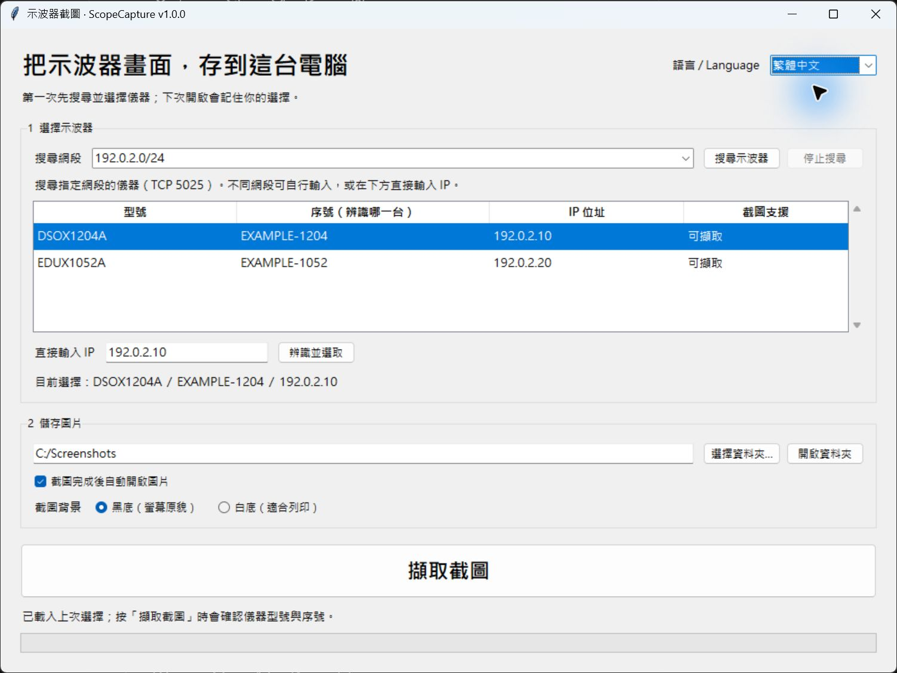

# ScopeCapture

繁體中文 | [English](README.md)

**按一下，直接把 Keysight 示波器畫面存到 Windows 電腦。**

只是想存一張圖，不想再拿 USB 隨身碟插來插去。這個小工具可搜尋儀器、選定並記住，下次按一下就能存成 PNG。

**[下載 Windows x64 版本](https://github.com/adrianhsu68/ScopeCapture/releases/latest)** · [使用說明](docs/guide.zh-TW.txt) · [問題回報](https://github.com/adrianhsu68/ScopeCapture/issues)



*畫面中的 IP 與序號均為示範資料。*

## 功能

- EXE 免安裝，不需另外安裝 Python、VISA 或 Keysight IO Libraries。
- 搜尋 IPv4 網段，或直接輸入示波器 IP。
- 依型號與序號選擇儀器，記住上次使用的那一台。
- 黑底／白底截圖，完成後還原儀器原本的省墨設定。
- 自動用時間、型號與序號命名 PNG，避免多台圖片混淆。
- 可自動開啟圖片，或持續存到指定資料夾。
- 繁體中文／英文即時切換，並記住語言、儀器、資料夾及截圖偏好。

## 開始使用

1. 從 [Releases](https://github.com/adrianhsu68/ScopeCapture/releases/latest) 下載 ZIP 並解壓縮。
2. 開啟示波器，讓示波器與電腦的網路能互通，再執行 `ScopeCapture.exe`。
3. 按「搜尋示波器」，或輸入 IP 並按「辨識並選取」。
4. 選對序號、指定資料夾與背景，按「擷取截圖」。

適用 Windows 10/11 x64，透過 IPv4、TCP **5025** 傳送 SCPI。尚未實作 USB 連線。建議網段以 /24 帶入，可自行修改，搜尋最多接受 /22（1024 個位址）；防火牆或 VLAN 隔離可能阻擋連線。

EXE 尚未經數位簽章。若公司政策阻擋，請交由資訊人員核准，不要關閉防護軟體。

## 支援型號

| 型號 | 驗證狀態 |
| --- | --- |
| Keysight DSOX1204A | 已實機驗證搜尋、截圖、黑白背景及省墨設定還原 |
| Keysight EDUX1052A | 已由使用者實機確認可用 |
| Keysight EDUX1052G、DSOX1202A/G、DSOX1204G | 依共用程式設計手冊實作，尚待實機驗證 |

指令依 [Keysight 1200 X-Series／EDUX1052A/G 官方手冊](https://www.keysight.com/us/en/assets/9018-07747/programming-guides/9018-07747.pdf) 實作。其他 SCPI 儀器可能出現在搜尋清單，但不開放截圖。本專案為獨立工具，與 Keysight 無隸屬關係。

每次截圖前會確認型號與序號。若 DHCP 更換 IP，請重新搜尋並選定；記住儀器不代表目前已連線。

## 截圖時的行為

程式讀取當下畫面，不會執行 Run/Stop、Autoscale 或更改量測設定。需要時會暫時調整 Ink Saver 省墨設定，完成後還原並確認。遇到逾時或不完整回覆會停止傳送後續指令，並提示使用者在面板確認省墨設定。

偏好設定儲存於本機 `%LOCALAPPDATA%/ScopeCapture/settings.json`。程式不會上傳截圖、不傳送遙測資料，也不需要帳號。搜尋會連線至指定網段內的 TCP 5025，請在有權使用的網路執行。

## 原始碼與打包

執行需要 Python 3 與 Tkinter，程式本身只使用標準函式庫。

```powershell
python scope_capture.py
```

在 Windows x64 打包（本版使用 Python 3.13.7、PyInstaller 6.16.0）：

```powershell
python -m pip install -r requirements-build.txt
./build.ps1 -Python python
```

腳本先跑測試，再於 `release/` 產生 EXE、中英文說明、授權文件、ZIP 與 SHA-256 校驗碼。打包輸出與中間檔不進版控。版本定義於 `scopecapture/__init__.py` 與 `version-info.txt`。

不需要示波器即可測試：

```powershell
python -m unittest discover -s test -t .
```

測試會使用本機 loopback 與 Tkinter，需要可開啟圖形視窗並允許本機通訊的 Windows 環境。

## 回饋與授權

歡迎回報問題或貢獻程式碼。請附型號、韌體版本、Windows 版本及完整錯誤訊息；發文前移除內部 IP、真實序號、使用者名稱及敏感截圖。新增型號需要核對其手冊並實機驗證。

本工具為個人專案，依空閒時間維護。原始碼採 [MIT 授權](LICENSE)，打包的執行環境各自適用其授權，詳見 [THIRD-PARTY-NOTICES.txt](THIRD-PARTY-NOTICES.txt)。
